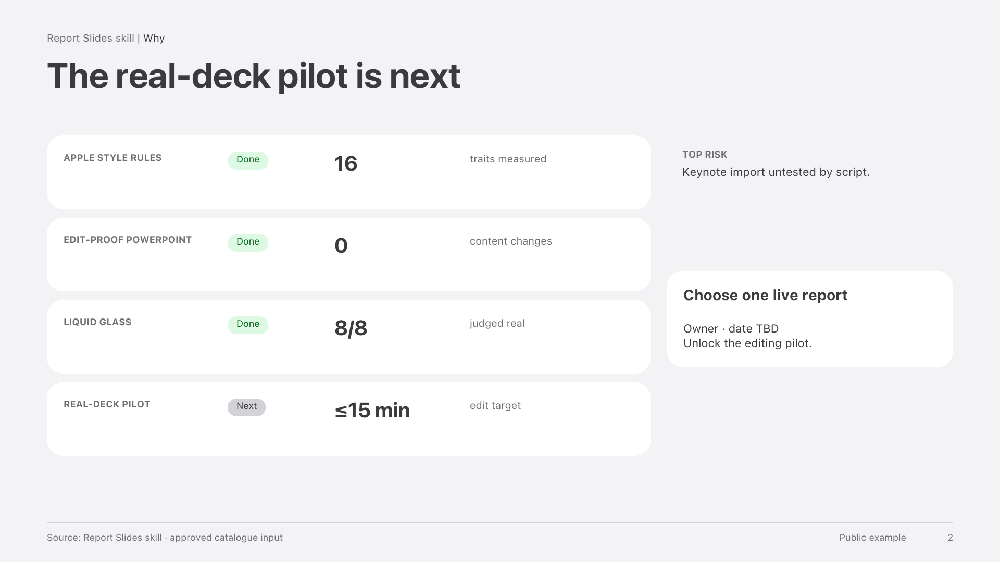
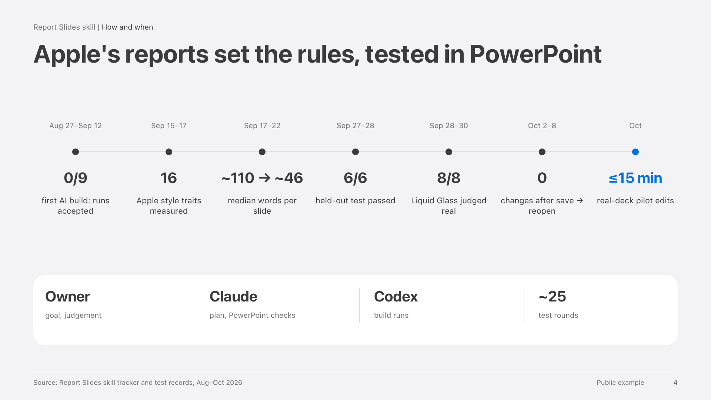
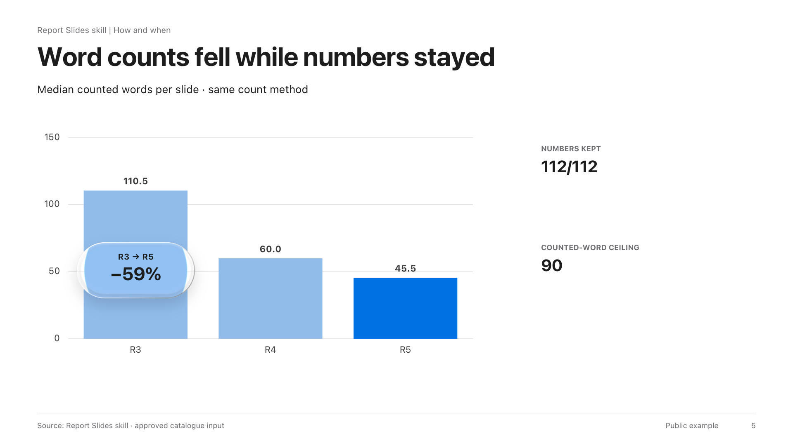
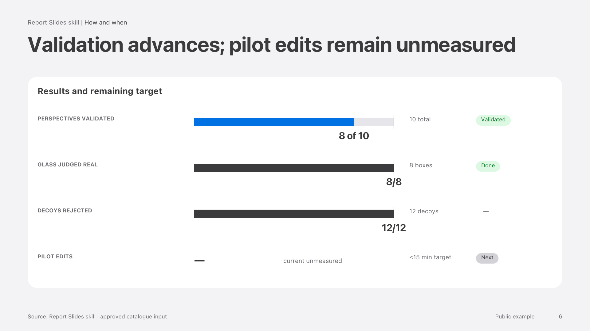
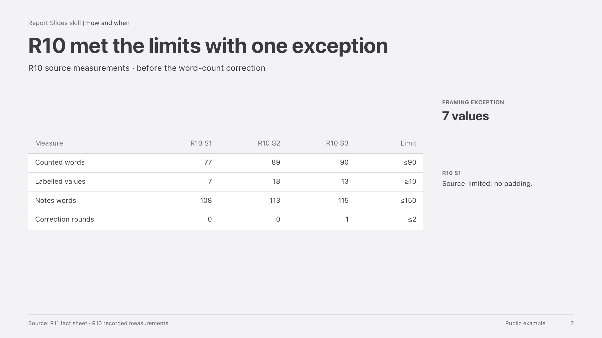
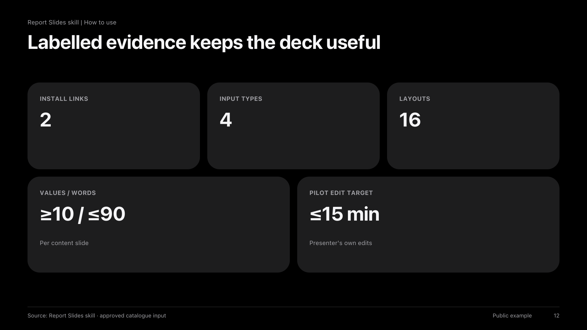

# Apple Report Slides

Turn reports, notes and data into editable engineering decks with labelled evidence and few words.

<p>
<a href="examples/skill-intro/pptx/S02.png"></a>
<a href="examples/skill-intro/pptx/S04.png"></a>
<a href="examples/skill-intro/pptx/S05.png"></a>
<a href="examples/skill-intro/pptx/S06.png"></a>
<a href="examples/skill-intro/pptx/S07.png"></a>
<a href="examples/skill-intro/pptx/S12.png"></a>
</p>

[Open the editable example](examples/skill-intro/deck.pptx) · [Browse its outline](examples/skill-intro/outline.md)

Native text, tables, charts, shapes and speaker notes stay editable. Supplied pictures remain pictures. Optional Liquid Glass uses a baked face with native text; rebuild after changing its position, text or backdrop. Every image must match its slide's subject; missing images remain visible placeholders.

## Before → after

| One line in `outline.md` | The slide it produces |
| --- | --- |
| S05 · Show word-count change · chart-interpretation · chart · Word counts fell while numbers stayed · R3/R4/R5 columns; 112/112; R3 → R5 −59%; ceiling 90 beside chart | [](examples/skill-intro/deck.pptx) |

## Quick start in 3 steps

1. **Clone** this repository into a local folder.

   ```sh
   git clone https://github.com/stanleyfeng1122-ui/Apple_Slides.git
   cd Apple_Slides
   ```

2. **Link** the skill to your assistant. Run the appropriate pair from the repository folder:

   ```sh
   # Codex
   mkdir -p "$HOME/.codex/skills"
   ln -s "$PWD/apple-report-slides" "$HOME/.codex/skills/apple-report-slides"

   # Claude Code
   mkdir -p "$HOME/.claude/skills"
   ln -s "$PWD/apple-report-slides" "$HOME/.claude/skills/apple-report-slides"
   ```

   If a link already exists, inspect it before replacing it.

3. **Ask** with the report and its classification attached:

   > Use apple-report-slides to make an engineering management deck from this report. Preserve the supplied numbers, qualifiers and status words. Use the classification “Public example”. Show me the outline before building, then deliver an editable PowerPoint.

The deck folder contains `outline.md`, `deck.html`, `deck.pptx` and the rendered slides in `pptx/`. HTML is the design source; PowerPoint is the deliverable. The workflow renders the deck, checks layout and text geometry, and fixes observed defects within its correction limit.

## What you need

- macOS with SF Pro Text and SF Pro Display.
- Local Google Chrome and Microsoft PowerPoint. LibreOffice is a preview fallback.
- Python 3.10 or later with `python-pptx`, `playwright`, `Pillow`, `numpy` and `pymupdf`.

The skill checks availability first. It does not download or install dependencies automatically. Sources, conversion and previews stay local.

## License

MIT, see [LICENSE](LICENSE). Third-party code keeps its own notice in `apple-report-slides/assets/THIRD_PARTY.md`.

## Credits and notice

- The HTML-first method follows [frontend-slides](https://github.com/zarazhangrui/frontend-slides) and [guizang-ppt-skill](https://github.com/op7418/guizang-ppt-skill). No code or templates were copied from them.
- The layout index and the deck check script take ideas from both projects (content-shape rules, measured layout checks). Both are re-implemented here; no code or text was copied.
- The glass optics are adapted from [rdev/liquid-glass-react](https://github.com/rdev/liquid-glass-react) (MIT). See `apple-report-slides/assets/THIRD_PARTY.md`.
- This is an independent project. It is not affiliated with or endorsed by Apple Inc. Apple and SF Pro are trademarks of Apple Inc.
